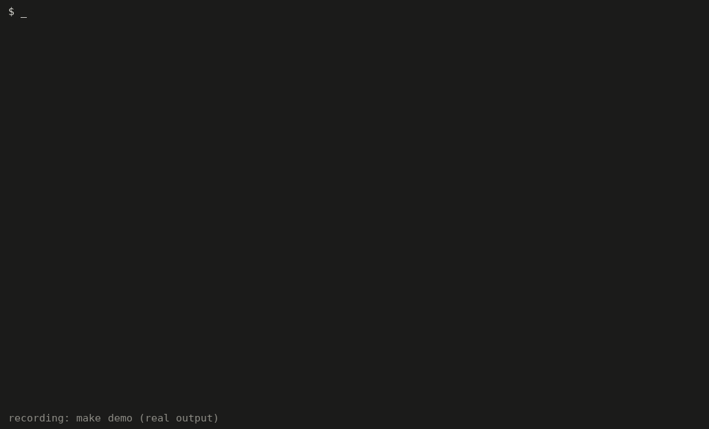
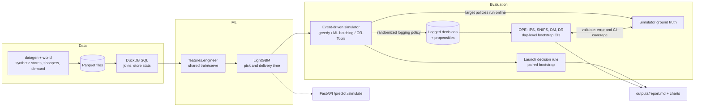

# DispatchLab: Counterfactual Simulator for Order Batching and Shopper Assignment

A grocery-fulfillment simulator that trains an ML model to predict shopper pick/delivery time and uses
off-policy counterfactual evaluation (OPE) plus an event-driven simulator to decide which batching and
assignment policy to launch, before any live test.

## Results (default config, seed 7, 21 simulated days)

| Policy | Late-order rate (95% CI) | Cost per order, total (95% CI) | Late rate vs baseline (paired 95% CI) | Cost vs baseline (paired 95% CI) |
|---|---|---|---|---|
| `greedy_nearest` (baseline) | 20.4% (13.9 to 27.0) | $20.01 (19.07 to 20.95) | n/a | n/a |
| `ml_batching` | 13.0% (9.3 to 16.7) | $19.45 (18.42 to 20.49) | -36.3% (-41.4 to -30.1) | -2.8% (-3.4 to -2.2) |
| **`ortools_assignment`** (recommended) | **10.3%** (6.7 to 14.0) | **$19.43** (18.33 to 20.52) | **-49.5%** (-55.8 to -44.1) | **-2.9%** (-3.8 to -2.0) |

Per-policy intervals are mean +/- 1.96 SE over days (days vary a lot with weekday and demand). The "vs baseline" columns use a paired
bootstrap over days on identical demand and noise, which is why they are much tighter. Cost per order includes paid idle time and fuel.

**How far off is OPE?** Across 8 independent logged datasets, the doubly robust estimate of per-order cost for the three batching-cap policies (never, always, ML-slack) was
within **1.1%** of the simulator's ground truth on average (SNIPS 1.1%, IPS 3.9%), but its 95% CIs covered the truth only 92% of the time
for cost levels and 69% for cost lifts. For the late rate, OPE was off by about 18% on levels and got the sign of the lift wrong, because logs
cannot see the congestion spillover from batching; that is why the launch call is made on the simulator. Details in the generated report.



*`make demo` end to end (real output, time-compressed from about 2.5 minutes to 60 seconds; re-render with `python docs/render_demo_gif.py`).*

## Architecture



## Features

- **Synthetic data generator** (stores, shoppers, time-of-day demand, configurable noise) stored as Parquet and queried with SQL through **DuckDB**.
- **LightGBM time model** predicting per-order pick and delivery (drive + handoff) minutes, with offline evaluation (MAE, p90 abs error, bias, decile calibration) and a **train/serve feature parity test**.
- **Event-driven simulator** comparing three policies on late-order rate, shopper idle time and cost per order:
  `greedy_nearest`, `ml_batching` (ML-slack batching + ML completion-time assignment), `ortools_assignment` (OR-Tools min-cost matching).
- **Off-policy evaluation**: IPS, self-normalized IPS, direct method and doubly robust estimators on logged randomized-policy data, with day-level bootstrap CIs, **validated against simulator ground truth** over independent replicates (CI coverage reported).
- **One-command launch-decision report** (`outputs/report.md` + 4 charts) with a recommended policy and expected lift with CIs.
- FastAPI service (`/predict`, `/simulate`, `/policies`, `/health`).

## Module map

```
world.py / truth.py  -> synthetic stores, shoppers, demand; ground-truth timing physics
datagen.py           -> history -> Parquet (orders, shoppers, stores, store_stats)
warehouse.py         -> DuckDB views + SQL (training join, store stats, demand by hour)
features.py          -> engineer(): the single feature function used by training AND serving
model.py             -> LightGBM pick/drive models, evaluate(), save/load
policies.py          -> batching-cap rules + assignment strategies (nearest, ML ETA, OR-Tools)
simulator.py         -> heap-based event loop: arrivals, hold expiries, shopper-free events
ope.py               -> IPS / SNIPS / DM / DR, cross-fitted reward model, cluster bootstrap
experiments.py       -> policy comparison, ground truth, OPE validation
decision.py          -> launch rule      report.py -> markdown + charts
api.py / cli.py      -> FastAPI service / `python -m dispatchlab`
```

## Setup

```bash
python -m venv .venv && . .venv/bin/activate
pip install -r requirements.txt
cp .env.example .env        # optional; every setting has a default, no secrets needed
set -a; . ./.env; set +a    # optional: export the settings (docker compose reads .env itself)
```

## Run

```bash
make demo                       # same as the next line, with progress output
python -m dispatchlab all       # generate -> train -> simulate -> OPE -> outputs/report.md (~2.5 min, 2 cores)
python -m dispatchlab generate  # only write Parquet data to data/
python -m dispatchlab train     # generate + train, print held-out MAE
python -m dispatchlab serve     # API on http://127.0.0.1:8000/docs
```

Docker (one command; writes `./outputs/report.md`):

```bash
docker compose run --rm --build report
# or: docker build -t dispatchlab . && docker run --rm -v "$PWD/outputs:/app/outputs" dispatchlab
docker compose --profile api up api     # API on :8000
```
(The Dockerfile/compose files were written but could not be built in the authoring sandbox, which had no Docker daemon access; CI builds the image.)

## Test

```bash
python -m pytest -q     # 23 tests, ~15 s
```

## Key design decisions

- **Shared feature function.** `features.engineer` is the only transform; training reads a SQL join, serving/simulation builds rows by in-memory lookup (`serving_frame`). `tests/test_data_and_features.py` asserts both paths give identical features.
- **Common random numbers.** Demand, noise multipliers and exploration uniforms are fixed per (seed, day), so policies are compared on identical days with paired bootstrap CIs. Day offsets are multiples of 7 so every block covers all weekdays equally.
- **OPE action space.** The logged action is a batching cap (1/2/3), chosen per (store, 30-minute slot) and shared by all orders in the slot (cluster randomization), so batch partners are co-treated. The logging policy is 50% ML-slack rule, 50% uniform, so propensities are known and bounded below by 1/6. Weights are clipped at 20; DR uses a 3-fold, day-grouped cross-fitted LightGBM reward model.
- **Honest validation finding.** OPE recovers the per-order **cost** effect of batching approximately (DR lift CI coverage about 69%, below the nominal 95%) but gets the **late rate** wrong: it sees the direct cost of holding orders (+6 to +8 pp) and misses the congestion spillover that makes batching lower lateness in the simulator (-1.5 to -1.7 pp). Interference between orders sharing a shopper pool breaks the usual OPE assumptions, so the report states this plainly and the launch decision is made on the simulator, with OPE as a pre-screen for direct effects.
- **Decision rule.** Launch the candidate with the lowest late rate whose late-rate change vs baseline has a 95% CI entirely below zero and whose total cost per order rises by at most 2%; otherwise keep the baseline.
- **Cost definitions.** *Total cost per order* = (shift wages including idle time + fuel) / orders. *Attributed cost per order* = wage for the batch's busy time + fuel, split across batch members; this is the per-order quantity used for OPE.
- **OR-Tools policy** uses a rule-of-thumb completion estimate minus waiting time (no ML) and solves a padded square assignment exactly with `SimpleLinearSumAssignment`. It does no batching; it differs from greedy by global matching, shopper speed/skill awareness and oldest-first priority.
- **Interpretation caveat.** The shopper pool (28) and demand (340 orders/day) are tuned so peaks are congested; policy rankings depend on that load. All data are synthetic; confirm with a small live holdout before a real launch.

## Resume line

> Built a fulfillment simulator with doubly-robust counterfactual evaluation that picked the best dispatch policy (OR-Tools assignment, -49.5% late orders vs greedy, 95% CI -55.8% to -44.1%), with off-policy estimates of per-order cost within 1.1% of simulated ground truth.

## Configuration

Environment variables (`DISPATCHLAB_*`, see `.env.example`): seed, data/output dirs, noise multiplier, shoppers, orders per day, history/eval/OPE days and replicates.
